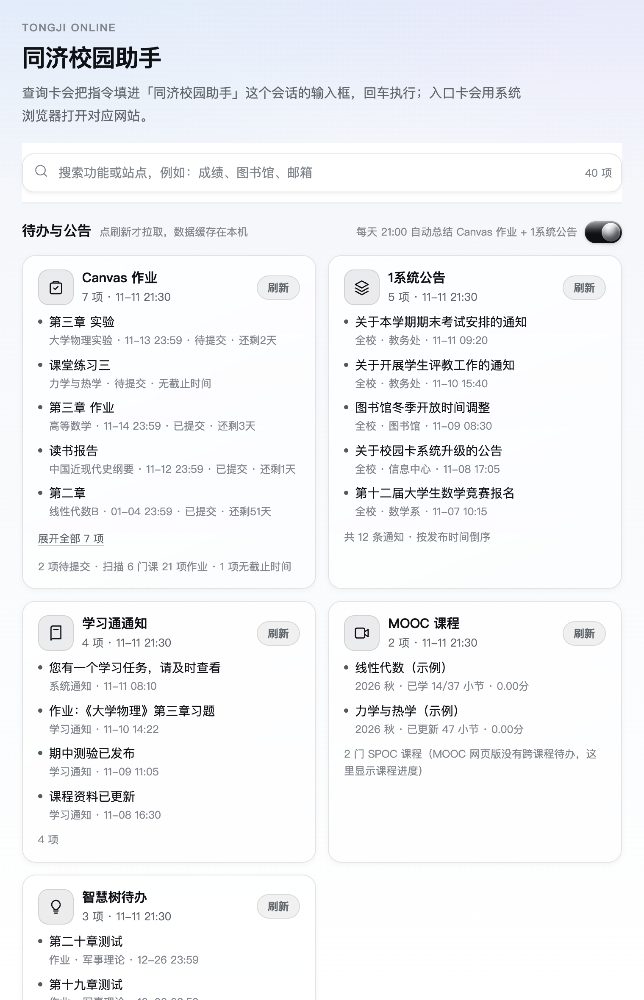
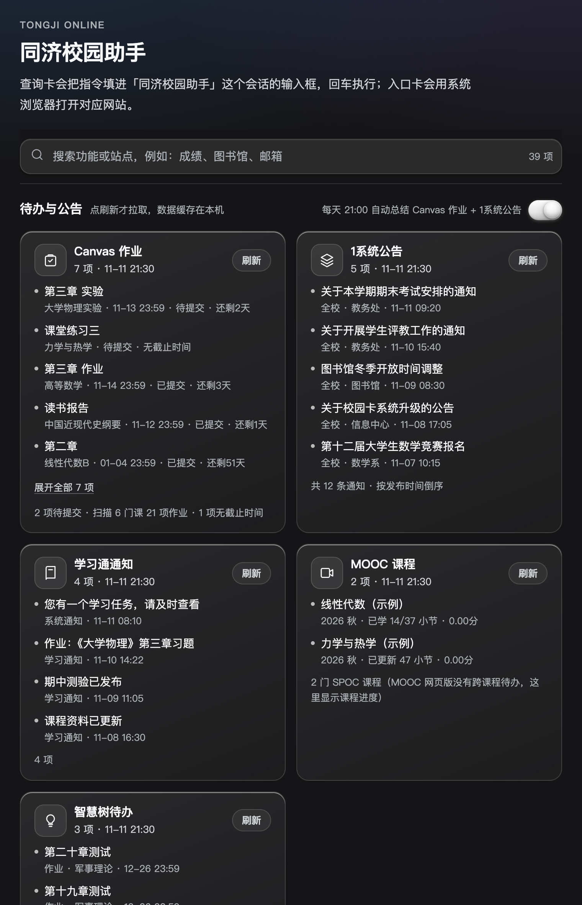
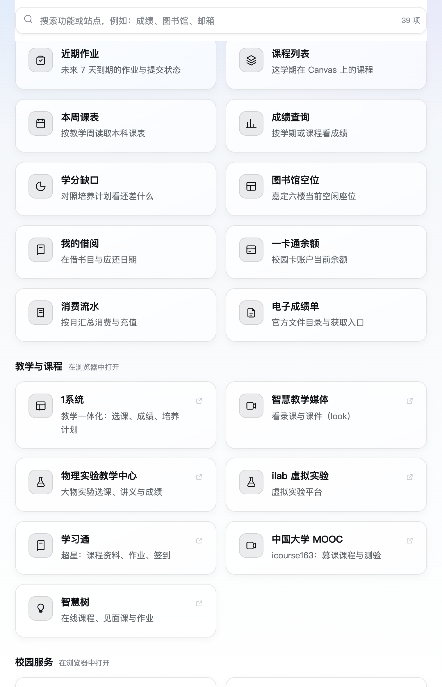
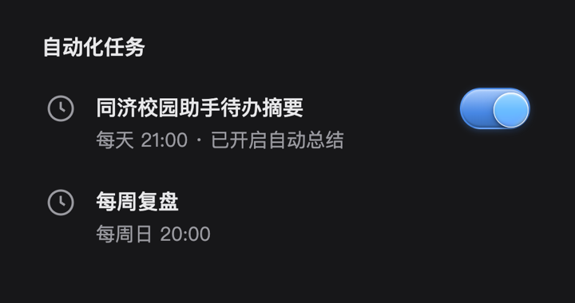

# 同济校园助手（Tongji Online Sidebar）

DSH 左侧栏的一个面板插件：把同济的课程作业、通知公告和常用校园入口收在一处。




## 它做什么

面板上有三类东西：

### 查询卡

点一下，把一句写好的指令填进当前会话的输入框，回车执行。实际查询由同仓库里的 [`skills/tongji-campus`](skills/tongji-campus) 技能完成，登录在你本机的浏览器里进行，凭据不经过这个插件。

### 入口卡

用系统浏览器打开对应网站。目前 32 个，按教学、校园服务、学术资源等分了 6 组，顶部搜索框按标题、说明和关键词别名过滤（比如搜 `agi` 能找到「人工智能服务平台」）。

### 待办与公告

五路数据汇总，每张卡一个刷新按钮，不轮询：

| 来源 | 内容 |
|---|---|
| Canvas | 全部作业与提交状态（含没有截止时间的） |
| 1系统 | 通知公告（按发布时间倒序） |
| 学习通 | 收件箱通知 |
| 中国大学 MOOC | SPOC 课程进度 |
| 智慧树 | 待完成任务 |

结果缓存在本地，打开面板先显示上次的，点刷新才重新抓。抓取需要登录态，第一次会弹一个 Chrome 窗口让你登录，之后静默复用。

Canvas 那一栏特意没走技能自带的 `canvas upcoming`：它会丢掉 `due_at` 为 null 的作业，还会按 14 天窗口过滤，实测 25 项作业里 7 项没截止时间的全被吞掉（其中一项还没交）。面板改成直接读 `/api/v1/courses/:id/assignments`，规则是：

- 未提交的 → 一律列出，没有截止时间的也列（显示「无截止时间」）
- 已提交的 → 只留截止时间在前后 30 / 90 天内的，免得一堆陈年旧作业
- 排序 → 待提交（有截止的按时间从近到远）→ 待提交（无截止）→ 已提交

卡片默认露 5 项，超过的给一个「展开全部 N 项」。1系统公告一律按 `publishTime` 降序，不吃 API 的置顶顺序 —— 那三条置顶是 2022/2024/2025 年的老通知。




上面的截图用的是编造的演示数据 —— 真实面板里是你的课程名和通知标题。

## 安装

需要 DSH Desktop。仓库里有两部分：

- `lib/` `scripts/` —— 面板插件本体
- `skills/tongji-campus/` —— 查询卡依赖的技能，负责登录和各站点查询

```bash
git clone https://github.com/Asaake-233/tongji-campus-assistant.git /tmp/tjca

# 1. 技能装到全局（所有工作区都能用）
cp -R /tmp/tjca/skills/tongji-campus ~/.dsh/skills/
cd ~/.dsh/skills/tongji-campus && npm install --omit=dev   # 装 playwright-core

# 2. 插件本体放到插件目录（技能不用重复拷）
mkdir -p ~/.dsh/plugins/tongji-online-sidebar
cp -R /tmp/tjca/lib /tmp/tjca/scripts /tmp/tjca/docs \
      /tmp/tjca/package.json /tmp/tjca/README.md /tmp/tjca/LICENSE \
      ~/.dsh/plugins/tongji-online-sidebar/

# 3. 让 DSH 加载它
dsh plugin --profile desktop add ~/.dsh/plugins/tongji-online-sidebar
```

技能的 `node_modules/` 没有提交（13M，`playwright-core` 而已），所以第 1 步要跑一次 `npm install`。

插件没有构建步骤，`lib/` 里就是最终代码。装完**完全退出并重开** DSH（⌘Q，不是 ⌘R）—— 宿主那一半不会热重载。

先跑一次自检，比直接开面板更容易看出哪里没配对：

```bash
cd ~/.dsh/plugins/tongji-online-sidebar
node scripts/smoke.mjs
```

它会打印解析到的路径、技能和 Chrome 在不在、缓存里各来源有多少条。

## 配置

路径都能用环境变量覆盖，默认值假设插件装在 `~/.dsh/plugins/`、技能装在 `~/.dsh/skills/` 下：

| 变量 | 默认 | 用途 |
|---|---|---|
| `DSH_WORKSPACE` | 用户主目录 | 工作区根 |
| `TONGJI_ONLINE_SKILL` | `~/.dsh/skills/tongji-campus/scripts/run.mjs` | 技能入口 |
| `TONGJI_ONLINE_HOME` | `~/.dsh/state/tongji-online` | 登录态、缓存、开关 |
| `TONGJI_ONLINE_PLAYWRIGHT` | 技能里的 `playwright-core` | Playwright |
| `TONGJI_ONLINE_CHROME` | 按平台猜 | Chrome 可执行文件 |
| `TONGJI_ONLINE_CDP_PORT` | `9333` | 登录窗口的调试端口 |

状态目录里的东西都别提交：`session.json` 是统一认证 cookie，`panel-cookies/*.json` 是各站的 storageState，都是明文凭据，权限 0600。

## 定时摘要

`scripts/digest.mjs` 会把数据源刷一遍，输出一份按紧急程度分好类的纯文本，可以直接贴进聊天。配合 DSH 的「自动化任务」就能每天定点收到：

```bash
node scripts/digest.mjs --scheduled
```

`--scheduled` 会先看面板里的开关：关掉之后到点也只回一句跳过。跑哪些来源同样由面板决定，默认 Canvas + 1系统。

```
三天内
  · 第三章 实验｜Canvas 作业｜大学物理实验 · 待提交 · 还剩 2 天
一周以后
  · 第二十章测试 ×20｜智慧树 · 12-26 截止
课程进度
  · 线性代数（示例）｜MOOC 课程 · 已学 14/37 小节
```

## 它是怎么工作的

- `lib/index.js` —— 宿主侧，注册 `/tongji/data`（读缓存）、`/tongji/refresh`（抓取）、`/tongji/settings`（开关）三个路由。
- `lib/client.js` —— 面板本体，一个自包含的客户端 bundle（`window.__ModuleLoader__` 协议）。
- `lib/panel.mjs` —— 缓存、刷新、五路数据源。
- `lib/scrape.mjs` —— 学习通 / MOOC / 智慧树的抓取，spawn 成独立进程跑 Playwright，不把浏览器塞进 Electron 主进程。
- `lib/login-cdp.mjs` —— 登录窗口。直接 spawn Chrome 可执行文件并开 CDP 端口，因为 `open -na --args` 会把参数丢掉、端口起不来。
- `lib/config.mjs` —— 所有路径解析都在这，别处不再拼路径。
- `skills/tongji-campus/` —— 独立的命令行技能，插件通过 `spawn` 调它（目前只用来做重新登录）。查询卡点下去只是把提示词填进会话，由 AI 去读技能文档再执行。

**关于那几个网页版没有待办页的**：MOOC 和智慧树的网页端没有跨课程的待办列表，所以这两张卡显示的是能拿到的东西 —— MOOC 显示 SPOC 课程进度，智慧树显示 `studyTask` 里的未完成任务。学习通的「待办」实际是收件箱通知流。

## 关于开关

「自动化任务」里那一行开关是**注入**进 DSH 原生设置页的：插件用 `MutationObserver` 找到标题匹配的行，把开关挂在 `<li>` 上（不是按钮里，避免按钮套按钮）。所以 DSH 改版换了类名也不会失效 —— 只认 `aria-label`。

开关外观是液态玻璃：SVG `feDisplacementMap` 做折射，`backdrop-filter: url(#...)` 引用它。纯 CSS 的 `blur()` 只能磨砂，做不出透镜。没有 canvas 的环境（jsdom、旧内核）会退化成普通模糊，开关照常能用。




滑块里的位移图是运行时用 Canvas 逐像素画的（4× 超采样后降采样），不是打包进来的位图 —— 96×96 的灰度法线图直接内联会撑大 bundle，画一遍只要几毫秒。

## 已知限制

- 只做了 macOS 上的验证。`login-cdp.mjs` 里的 `osascript` 抬窗是 macOS 专用，其他平台会跳过。
- 面板宽度是按侧栏（约 380px）排的三列，窗口拉很宽时卡片会显得空。
- 学习通 / MOOC / 智慧树的抓取依赖页面结构，对方改版就可能失效。
- 1系统公告的 `sessionId` 只有几小时有效期，过期后刷新会自动重登一次（可能弹窗）。
- Canvas 无截止时间的作业按「未提交就列出来」处理，所以一门课如果长期挂着一堆没截止的练习，它们会一直在列表里。
- 面板不轮询。想要新数据就点刷新。

## 许可

MIT
